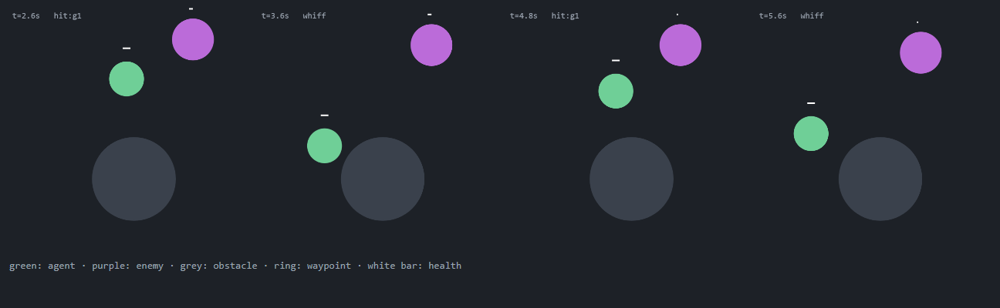
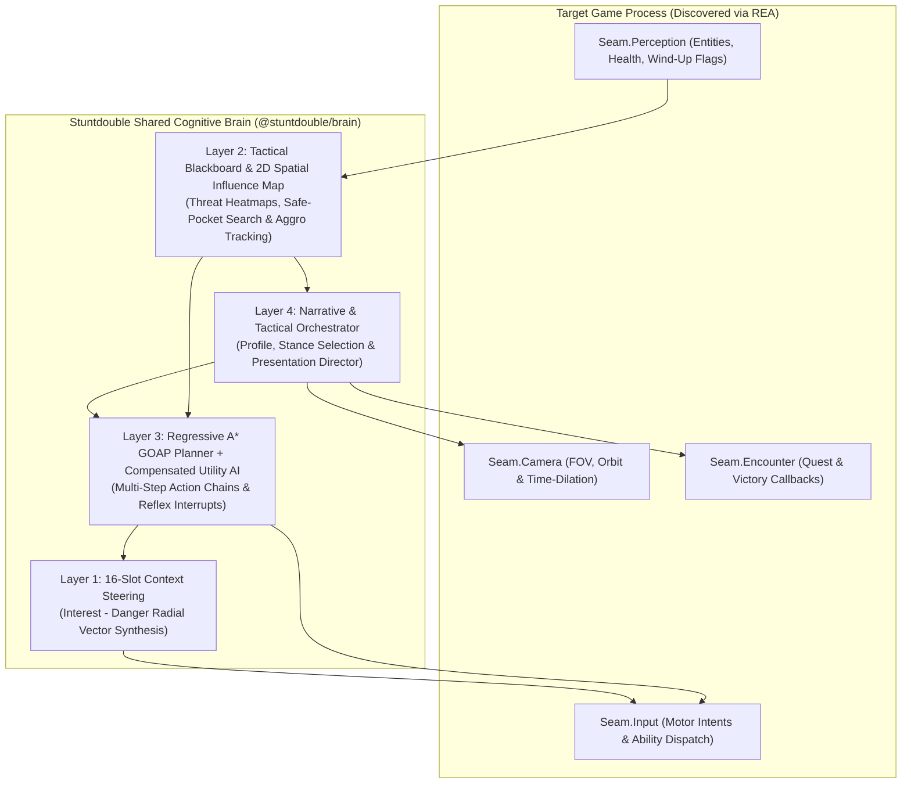

# Stuntdouble

by [Yusuf Günay](https://github.com/yusufgunay-esq)

### Competent combat hand-over for story-driven single-player games

**An Open-Source, User-Configurable Game AI & Reverse-Engineering Protocol for Single-Player Games**

[](LICENSE)
[](https://github.com/yusufgunay-esq/stuntdouble/actions/workflows/ci.yml)



[Whitepaper & Math](paper/WHITEPAPER.md) · [Roadmap](docs/ROADMAP.md) · [Arena](packages/stuntdouble-arena/) · [Agent Skill Protocol](skills/stuntdouble/SKILL.md) · [Shared Brain SDK](packages/) · [Profile Schema](schemas/profile.schema.json) · [Profile Presets](schemas/profiles.json) · [Target Recipes](targets/)

## Quick Verification

Node.js 22.6+ (TypeScript runs through `--experimental-strip-types`; no npm dependencies):

```bash
npm test                  # kernel + seam + arena tests, arena gate table, profile validation, fixture freshness, C# conformance if dotnet exists
npm run arena             # gate table only
npm run conformance:all   # strict C# / C++20 / Lua runners (CI does this)
```

---

## Abstract

> **What it is for.** Some players want the story, not the fifty filler fights in between, or they simply want to watch the character play well. Stuntdouble is the *working* version of the old "bot takes over for me" toggle: it hands the fighting to a competent agent and gives control back when the fight is over. The profile is five optional knobs with sensible defaults, not a persona. Deriving the story protagonist's real fighting style from the binary (**Protagonist Fidelity**) and "let the AI work out the game by itself" stay open Phase-2 ideas, not part of the core.

Narrative-driven games frequently cast the player as an elite covert operative, a mythic mercenary, or a veteran battlefield commander, yet rely strictly on repetitive manual motor execution across hundreds of filler combat encounters. Existing "bot takeover" toggles (`is_human = false` in sandbox battle simulators or idle-takeover scripts in co-op shooters) fail to bridge this gap: standard NPC brains are engineered as expendable opposition (written to lose), so they degrade into naive "charge-nearest-enemy" loops when bound to a player character.

**Stuntdouble (Competent combat hand-over for story-driven single-player games)** is both an **AI Coding Agent Skill** (built to operate alongside [REA - Reverse Engineer Anything](skills/stuntdouble/SKILL.md)) and a **Shared Multi-Language Cognitive Brain SDK**. Point an agent (Claude Code, Antigravity, Codex, Cursor) at an installed single-player game and say:

> *"Stuntdouble this game: when combat starts, let my character fight on its own and give it back to me afterwards."*

### Architecture order (how Stuntdouble treats the game's own AI)

1. **The game's own AI is the foundation** (strategies S1 companion/elite-NPC brain, S2 developer autoplay): its animations and mechanics are already correct.
2. **Stuntdouble is a competence layer on top.** The native AI was written to lose, so Stuntdouble only overrides its weak moments: parry/dodge on a wind-up, retreat at low health, target choice, oscillation damping. Every override is recorded with its reason.
3. **If the native AI is unreachable (DRM etc.), Stuntdouble's brain drives alone** (S3 in-process, S4 external bridge).
4. **Story-first shortcut S5:** clean encounter resolve.

Where an anti-cheat or DRM wall makes any of this unsafe, the answer is to stop: see [`targets/ghost-recon-breakpoint/REPORT.md`](targets/ghost-recon-breakpoint/REPORT.md) (ABORT example) and [`targets/assassins-creed-odyssey/REPORT.md`](targets/assassins-creed-odyssey/REPORT.md) (VMProtect: external S4 only).

---

## 1. Composable Behaviors (Five Presets) and Hand-over Policy

The brain takes a **bit mask of behaviors**; the five classic modes are named presets over it (`AUTONOMY_PRESETS`):

| Flag | Bit | Meaning |
|---|---|---|
| `COMBAT` | 1 | Fight: close in, chain attacks, parry/dodge. |
| `ASSIST` | 2 | Human drives; Stuntdouble intercepts only for an urgent reflex (parry/dodge on a wind-up, heal at low health). Inert while `COMBAT` is set and an enemy exists. |
| `CRUISE` | 4 | Out of combat: follow waypoints, loot. Runs only while no enemy exists. |
| `DEFENSIVE` | 8 | Never attack; weave, space and parry. Overrides offense. |
| `COMMAND` | 16 | Player issues doctrine orders, Stuntdouble executes motor combat. |

| Preset (`AutonomyMode`) | Mask | Experience |
|---|---|---|
| `FULL_COMBAT` (default) | `COMBAT` | Stuntdouble fights, parries, dodges and chains abilities on the native camera. |
| `CO_PILOT` | `ASSIST` | "I drive, Stuntdouble parries": human input passes (`HUMAN_PASS_THROUGH`) except urgent reflexes. |
| `GRIND_AUTOPILOT` | `CRUISE`+`COMBAT` | Chore and loot cruise, fights when ambushed. |
| `SHADOW_SURVIVAL` | `DEFENSIVE` | Zero-offense boss pattern coach. |
| `COMMANDER` | `COMBAT`+`COMMAND` | Macro orders, Stuntdouble does the motor work. |

Decision (001): **if no behavior is active** (mask 0, `CRUISE` alone while an enemy exists, `COMMAND` alone) the output is `HUMAN_PASS_THROUGH`: no intercept, no steering. Cycling presets in a game (an optional hotkey) walks the five presets; arbitrary masks are set by the user's words, not a key.

**Hand-over (`StuntRuntime`, [`packages/stuntdouble-seams-ts`](packages/stuntdouble-seams-ts/src/index.ts)).** Default `engage: 'onCombat'`: Stuntdouble takes over as soon as a hostile is perceived and gives control back after the fight (no hostile for 2 s). `engage: 'manual'` uses a toggle bound to a key *you* choose (`toggleKey`; no fixed key). In both modes, manual input hands control back at once, and cutscene / menu / loading interlocks keep Stuntdouble inert (no command or steering is written; at most one neutral `release`). The arena proves each of these (section 4).

### Optional Post-Core Extensions (Phase 2 — Added Only When Requested)

| Extension ID | Name | Optional Capability |
|---|---|---|
| `Ext.Camera` | **Dynamic Action Camera** | Optional plugin (`CINEMATIC_LIVE`) that orbits the camera or triggers brief hit-stop slow-motion (`0.35x`) on counters and finishers. |
| `Ext.Audio` | **Reactive Combat Music / Stingers** | Optional hook that swells dynamic combat music or protagonist theme stingers during high-utility maneuvers. |
| `Ext.Resolve` | **Choreographed Fast-Resolve** | Optional hook (`CINEMATIC_RESOLVE`) that fires native encounter-victory callbacks for players who want to skip filler fights cleanly. |
| `Ext.Telemetry` | **Scientific Benchmark Logger** | Exports per-tick GOAP plans, Utility scores, and Influence Map entropy to CSV/JSON for academic theses and research papers. |

---

## 2. Four-Layer Cognitive Architecture

To prevent each game mod from reinventing fragile `if/else` combat scripts, every target links against the unified **Stuntdouble 4-Layer Cognitive Architecture** ([full mathematical formulation in `paper/WHITEPAPER.md`](paper/WHITEPAPER.md)):



### Formal Algorithmic Guarantees
1. **Makeup-Value Compensated Utility Scoring (Dave Mark):** Reflex actions $a \in \mathcal{A}_U$ with $n$ normalized considerations $q_i \in [0,1]$ apply compensation factor $\mu = 1 - \frac{1}{n}$ via $\hat{q}_i = q_i + (1 - q_i)\mu q_i$, ensuring complex multi-condition maneuvers (e.g., `DEFLECT_COUNTER` on enemy wind-up) are never mathematically penalized against single-condition attacks.
2. **Regressive $A^*$ GOAP Synthesis (Jeff Orkin):** Multi-step combat chains (`CLOSE_DISTANCE` $\rightarrow$ `HEAVY_ASSAULT` $\rightarrow$ `EXECUTE_FINISHER`) are planned backward from the Orchestrator's desired goal state $G^*$ to the live world state $W_t$.
3. **16-Slot Context Steering (Andrew Fray):** Evaluates 16 radial basis vectors $\mathbf{d}_k$ on the XZ plane, subtracting repulsive hazard cones $D_k$ (weighted by enemy wind-up telegraphs) from target ring interest $I_k$ to eliminate obstacle-oscillation traps.

---

## 3. Shared Multi-Language Brain SDK (`packages/`)

Because game modding spans managed C#, native C++, embedded Lua, and out-of-process TypeScript, Stuntdouble maintains a synchronized, zero-dependency implementation of the 4-Layer Brain across all four ecosystems. Every target game adapter stays a thin 150-line bridge that feeds `EntitySnapshot` structs into the shared kernel:

| Package Path | Target Engines & Mod Loaders | Implementation Highlights |
|---|---|---|
| [`packages/stuntdouble-brain-ts`](packages/stuntdouble-brain-ts/src/index.ts) | Reference Spec, Electron/JS Games, External Bridges | Full TypeScript reference kernel + automated test suite (`npm test`). |
| [`packages/stuntdouble-brain-cs`](packages/stuntdouble-brain-cs/StuntBrain.cs) | Unity Mono & IL2CPP (`BepInEx`, `MelonLoader`), .NET | Single-file drop-in C# kernel (`Stuntdouble.Brain.StuntBrainKernel`), zero GC allocation in steering loop. |
| [`packages/stuntdouble-brain-cpp`](packages/stuntdouble-brain-cpp/include/stuntdouble/stunt_brain.hpp) | Native C++ Engines (`AnvilNext`, `Unreal C++`, `MinHook` Proxy) | Header-only C++20 (`stuntdouble::BrainKernel`), `constexpr`/stack-allocated `std::array` slots. |
| [`packages/stuntdouble-brain-lua`](packages/stuntdouble-brain-lua/stunt_brain.lua) | `UE4SS` (Unreal 4/5), `Cyber Engine Tweaks` (`REDengine`), `Source` | Pure Lua 5.1+/LuaJIT module with identical compensated utility and 16-slot steering. |

---

## 4. Adapter Seam Contract and the Arena

When an AI agent is instructed to **Stuntdouble a target game**, it follows [skills/stuntdouble/SKILL.md](skills/stuntdouble/SKILL.md) to find the game's seams with REA and implement the contract in code ([`packages/stuntdouble-seams-ts`](packages/stuntdouble-seams-ts/src/index.ts); C# mirror in [`StuntSeams.cs`](packages/stuntdouble-brain-cs/StuntSeams.cs)):

| Seam | Tier | Contract | Required Binary Evidence |
|---|---|---|---|
| `PerceptionSeam` (`Seam.Perception`) | **Core** | `self()`, `hostiles()`, `waypoint()` | Entity array, health/stamina, enemy wind-up flags. |
| `InputSeam` (`Seam.Input`) | **Core** | `command(id)`, `steer(dir, speed)`, `release()` | Internal command handlers (`Move`, `Attack`, `Parry`, `Dodge`). |
| `InterlockSeam` | **Core (safety)** | `cutscene()`, `menu()`, `loading()`, `manualOverride()` | State flags for dialogue, menus, loading, controller activity. |
| `NativeAiSeam` (`Seam.NpcAI`) | Optional, preferred | `available()`, `proposeCommand()` | Behavior tree / combat evaluator / autoplay switch (S1/S2). |
| `Ext.Camera`, `Ext.Audio`, `Ext.Encounter` | *Optional (Phase 2)* | - | FOV/time scale, music hooks, encounter callbacks. |

[`targets/_template/adapter-checklist.md`](targets/_template/adapter-checklist.md) maps each seam to the arena gate that proves it.

### The Arena: evidence that the brain actually plays

[`packages/stuntdouble-arena`](packages/stuntdouble-arena/) is a deterministic (seeded) 2D simulator that drives `StuntRuntime` through these seams: enemies approach, telegraph a wind-up, strike; parry and dodge windows; damage; obstacles; waypoints and loot. Eight scenarios (duel, 3-enemy surround, archer + melee, DEFENSIVE boss combo, cruise + ambush, onCombat hand-over, native-AI overlay, interlocks) must pass fixed gates: survival, telegraphed strikes avoided, zero attacks under `DEFENSIVE`, bounded steering reversals, zero input while locked, same-tick manual hand-back, takeover and hand-back timing, and "native AI + Stuntdouble beats the same native AI alone".

```bash
node packages/stuntdouble-arena/run.mjs                    # table of gates, exit 1 on failure
node packages/stuntdouble-arena/run.mjs --scenario duel --seed 3 --json
node packages/stuntdouble-arena/run.mjs --html replay.html # single-file replay (works on a phone; shows projectiles)
node packages/stuntdouble-arena/run.mjs --compare           # 4 agents x 3 difficulty tiers, fixed hard-tier gate
```

**Difficulty tiers and agent comparison.** Three extra scenarios (`arena_t1..t3`) use a harder enemy model: variable wind-ups, feints (fake wind-up, then a quick real one), coordinated simultaneous strikes, flanking, archers with real projectiles that lead a moving target, a multi-hit boss combo, and a one-hit parry. `--compare` runs four agents on the same seeds (1-8): (a) naive bot (nearest enemy, swing), (b) weak native AI (heals, guards only late and sometimes, blind to ranged/feints), (c) Stuntdouble alone, (d) weak native AI + Stuntdouble layer. Measured result:

| Hard tier (arena_t3) | survived | hp end | damage taken | hits |
|---|---|---|---|---|
| (a) naive bot | 0/8 | 0 | 112 | 9.9 |
| (b) weak native AI | 5/8 | 40 | 142 | 11.1 |
| (c) Stuntdouble | 8/8 | 81 | 19 | 3.0 |
| (d) native + Stuntdouble | 8/8 | 79 | 30 | 4.9 |

Tier gates also bound human-plausibility: steering reversals, wall hugging (<= 15% of ticks at the edge), single-command spam (<= 85%), and zero hits from telegraphs the brain could not see. The brain reacts to ranged wind-ups up to 16 m and to projectiles in flight (optional `projectileEta`): lateral sidestep, dodge timed to the impact.

What this does **not** prove: real-game behavior. It proves the brain and runtime contract in a simplified world; every real adapter still needs its own live check. Known limits: the original 8 scenarios keep the simpler enemy model; the hard tier's boss and enemy numbers are tuned for this simulator, not for any real game.

---

## 5. Collective Game Autonomy Atlas (Local Verification, Consent, Bundle)

The atlas is **not** this code repository: per [docs/ROADMAP.md](docs/ROADMAP.md) it is a separate data repo with a single writer and approved submissions only. The flow today:

1. **Lookup first (`Stage 0`):** check `targets/<game-slug>/` here for a recipe before reverse engineering again.
2. **Local verification (`Stage 7`):** the agent audits the recipe on the contributor's machine (no binaries, no personal paths) and shows the user exactly what would be sent.
3. **With the user's consent only**, it writes an atlas bundle:
   ```bash
   node scripts/contribute-recipe.mjs <game-slug> --dry-run                          # audit only
   node scripts/contribute-recipe.mjs <game-slug> --bundle out.json --user-approved  # local bundle
   ```
4. **Submission is not open yet.** The script opens no pull request and talks to no repository; the bundle stays on your disk until the atlas intake exists.

---

## 6. Profile: Five Optional Knobs, Not a Persona

The profile is **five numbers** (`aggression`, `discipline`, `cinematicFlair`, `reactionDelayMs`, `preferredRange`) plus a free-form label. It **starts from a ready preset and works well unchanged**; the user adjusts it in plain words ("be more careful", "stay at range") and the agent edits the numbers. It works for any controllable unit: the player character, a companion, any NPC.

**Phase 2 (open idea, not a promise): Protagonist Fidelity.** REA could derive the numbers from the protagonist's real animation and commitment behaviour; the schema would be identical, only the *source* of the numbers differs.

Stuntdouble ships **no closed taxonomy of playstyles**: an arcane duelist, a drunken brawler and a pacifist monk are all first-class.

| | Closed taxonomy (rejected) | Stuntdouble's approach |
|---|---|---|
| How the style is chosen | Pick one of five boxes | Start from a preset, adjust by words (or, in Phase 2, derive from REA evidence) |
| Games that do not fit | Forced into the nearest box | Author their own `profile.json` |
| `archetype` label | Enum, validated against a list | Free-form string, any label the game deserves |

Concretely:

1. **[`schemas/profile.schema.json`](schemas/profile.schema.json)** validates ranges and shapes only — `archetype` is a free-form label, not an enum.
2. **[`schemas/profiles.json`](schemas/profiles.json)** holds five **optional starting templates** (including an `ARCANE_SCHOLAR` and a `RANGED_SKIRMISHER`, both missing from the old enum). Start from the closest one and adjust; a game-specific profile should be re-tuned against evidence.
3. **Every target writes its own** `targets/<game-slug>/profile.json`, with an `evidence` array recording which symbols and timings justified each parameter, validated by `node scripts/validate-profiles.mjs <game-slug>`.

Derivation is prescriptive, not vibes: `preferredRange` comes from weapon reach and attack-animation distance, `aggression` from the ratio of committed attacks to repositioning in the combat state machine, `discipline` from the parry-window length found in `Seam.Input`, `cinematicFlair` from the presence of counters/finishers/hit-stop hooks, and `reactionDelayMs` from dodge/parry commitment frames. For a profile that claims to be evidence-derived, being byte-identical to a preset is a specification failure.

---

## 7. Repository Structure

```text
Stuntdouble/
├── .claude-plugin/          # Agent plugin manifest (Claude Code / Antigravity)
├── packages/
│   ├── stuntdouble-brain-ts/       # Reference 4-Layer Cognitive Kernel (TypeScript + Node test suite)
│   ├── stuntdouble-brain-cs/       # Drop-in C# Kernel + StuntSeams.cs (BepInEx / MelonLoader)
│   ├── stuntdouble-brain-cpp/      # Header-only C++20 Kernel for Native DLL Hooking
│   ├── stuntdouble-brain-lua/      # Portable Lua Kernel for UE4SS / Cyber Engine Tweaks
│   ├── stuntdouble-seams-ts/       # Seam contract + StuntRuntime (engage policy, interlocks, native-AI override)
│   ├── stuntdouble-arena/          # Deterministic simulator + automatic gates (run.mjs)
│   └── conformance/           # Cross-language fixtures and C#/C++/Lua runners
├── paper/ docs/               # Whitepaper and roadmap (CC BY 4.0, see LICENSE-CC-BY-4.0.md)
├── schemas/                   # Profile contract + five OPTIONAL starting presets
├── scripts/                   # Hygiene audit / atlas bundle, profile validator, conformance drivers
├── skills/stuntdouble/             # Agent skill, strategy ladder (S1-S5), engine matrix
└── targets/                   # Per-game recipes (_template, assassins-creed-odyssey, ghost-recon-breakpoint)
```

---

## 8. Scope & Operational Ethics

- **Single-Player & Offline Only:** Stuntdouble strictly targets offline, single-player games. Targets with online competitive modes or kernel anti-cheat drivers (`EAC`, `BattlEye`, `Vanguard`) are rejected at Stage 1 reconnaissance.
- **Zero Proprietary Assets:** No game binaries, `.pak` files, or proprietary assets are ever committed to this repository—only clean-room adapter source code, profile definitions, and REA seam documentation.

---

## Citation

If you build upon Stuntdouble's cognitive architecture, profile schemas, or target adapters in academic work or open-source projects, please cite [`CITATION.cff`](CITATION.cff). The text below is identical to its `preferred-citation`:

> Günay, Y. (2026). *Stuntdouble: Competent combat hand-over for story-driven single-player games* (Version 1.0.0) [Computer software & Cognitive Architecture Specification]. https://github.com/yusufgunay-esq/stuntdouble

```bibtex
@software{gunay2026stuntdouble,
  author    = {G{\"u}nay, Yusuf},
  title     = {{Stuntdouble: Competent combat hand-over for story-driven single-player games}},
  year      = {2026},
  version   = {1.0.0},
  note      = {Computer software \& Cognitive Architecture Specification},
  license   = {MPL-2.0},
  url       = {https://github.com/yusufgunay-esq/stuntdouble}
}
```

## License & Mandatory Academic Attribution

1. **Software & SDK (`packages/`, `skills/`, `targets/`, `scripts/`, `schemas/`):** **Mozilla Public License 2.0 (MPL-2.0)**. Modified covered files stay open under the same license; the copyright notice crediting **Yusuf Günay** must be retained ([`LICENSE`](LICENSE), [`NOTICE`](NOTICE)). Your own separate code can stay closed.
2. **Whitepaper and roadmap (`paper/`, `docs/`):** **Creative Commons Attribution 4.0 International (CC BY 4.0)**, see [`LICENSE-CC-BY-4.0.md`](LICENSE-CC-BY-4.0.md). Any thesis, paper, preprint or technical report that uses or evaluates Stuntdouble must credit **Yusuf Günay** with the citation above.
